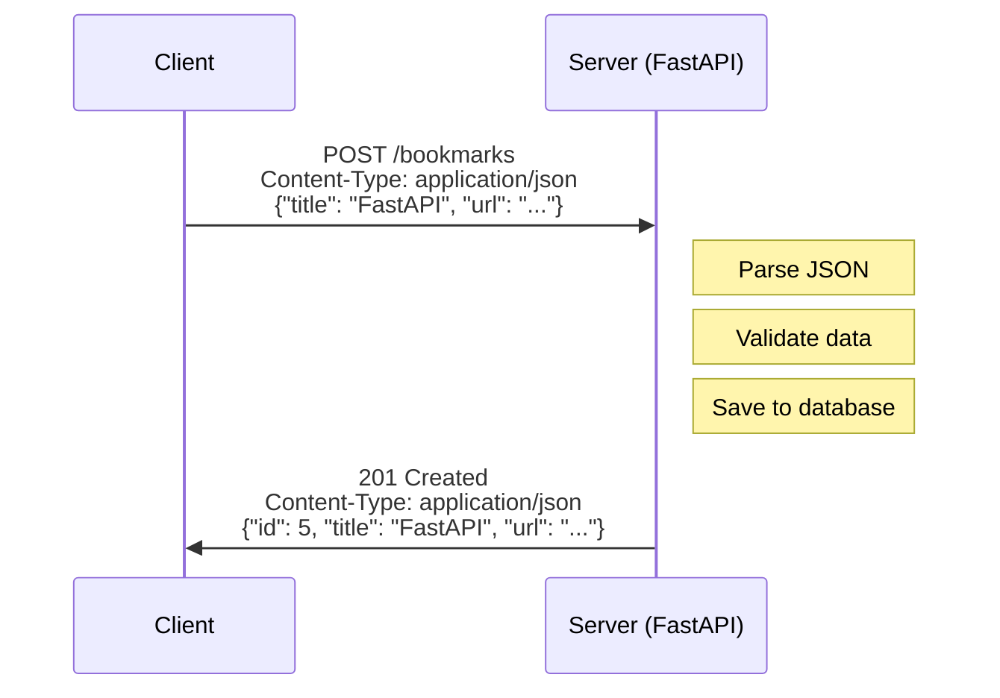

# Lesson 02: APIs and JSON

## What We're Doing
Understanding what an API actually is and how JSON works as the data format that APIs use to communicate.

## Why / Context

In Lesson 01 you learned how HTTP works — requests and responses flying back and forth between a client and a server. But we were vague about what exactly the server *is*. Is it a website? A database? Some mysterious box?

When you're building with FastAPI, the server you're creating is an **API** — an Application Programming Interface. The key word there is "interface." It's a way for programs to talk to each other. Not humans clicking buttons on a website, but code talking to code.

And when code talks to code, it needs a shared data format — something both sides understand. That's where **JSON** comes in. JSON is the universal language of web APIs. Almost every API you'll interact with speaks JSON.

By the end of this lesson, you'll understand what APIs are, why they exist, and how JSON works as the data format that holds everything together.

## Concepts

### Concept: `API` — What It Actually Is

An API is just a set of URLs (called **endpoints**) that a server exposes for other programs to interact with. Instead of serving HTML pages for humans to look at, an API serves raw data for other programs to use.

Think about it this way: when you go to a restaurant, you don't walk into the kitchen and grab food yourself. You use the **menu** — it tells you what's available and how to order it. The menu is the interface between you and the kitchen. An API is the same thing, but between programs.

For example, a bookmarks API might expose these endpoints:

```
GET    /bookmarks        → get all bookmarks
GET    /bookmarks/42     → get bookmark #42
POST   /bookmarks        → create a new bookmark
PUT    /bookmarks/42     → update bookmark #42
DELETE /bookmarks/42     → delete bookmark #42
```

Each line is an endpoint — a combination of an HTTP method and a URL path. Together, they form the API's "menu." Any program that knows these endpoints can interact with your bookmark data — a web app, a mobile app, a command-line tool, another server. The API doesn't care who's calling it, as long as the request follows the rules.

This is why APIs are so powerful: **you build the backend once, and any frontend can use it.** A React web app and an iPhone app can both talk to the same FastAPI server.

---

### Concept: `REST` — A Style of API Design

You'll hear the term "REST API" or "RESTful API" a lot. REST stands for **Representational State Transfer**, which is a mouthful that basically means: "organize your API around resources and use HTTP methods the way they were intended."

A resource is just a "thing" your API manages — users, bookmarks, posts, orders, whatever. REST says:

- Each resource gets its own URL path (`/users`, `/bookmarks`)
- You use HTTP methods to say what you want to do with that resource (GET to read, POST to create, PUT to update, DELETE to remove)
- The server sends back representations of those resources (usually as JSON)

You've actually already seen a REST API — that bookmarks example above follows REST conventions. The endpoints are organized around the "bookmark" resource, and the HTTP methods tell the server what action to take.

REST isn't a strict rule book — it's more like a set of conventions that most APIs follow because they make things predictable. When you see a new API, you can usually guess that `GET /users` returns a list of users and `POST /users` creates one, because that's the REST pattern.

FastAPI doesn't force you to follow REST, but it makes it very natural to do so. Most of what you'll build will be RESTful.

---

### Concept: `JSON` — The Data Format

JSON stands for **JavaScript Object Notation**. Don't let the "JavaScript" part fool you — JSON is used everywhere, in every language. It's just a text format for representing structured data.

If you've used Python dictionaries, JSON will feel instantly familiar. Here's a JSON object:

```json
{
    "name": "FastAPI Tutorial",
    "url": "https://fastapi.tiangolo.com",
    "tags": ["python", "api", "backend"],
    "is_favorite": true,
    "rating": null
}
```

That's it. Curly braces, keys in quotes, values after colons, commas between entries. It looks almost identical to a Python dictionary — and that's not a coincidence. When FastAPI receives JSON, it converts it into Python objects. When it sends a response, it converts Python objects back to JSON. You'll barely think about JSON directly because FastAPI handles the conversion.

#### Data Types in JSON:

- **Strings** — text in double quotes: `"hello"`. Must be double quotes, not single quotes (unlike Python where both work).
- **Numbers** — integers or decimals, no quotes: `42`, `3.14`
- **Booleans** — `true` or `false` (lowercase, not Python's `True`/`False`)
- **Null** — `null` (not Python's `None`)
- **Arrays** — ordered lists in square brackets: `["a", "b", "c"]` (like Python lists)
- **Objects** — key-value pairs in curly braces: `{"key": "value"}` (like Python dicts)

The small differences from Python are worth noting because they'll bite you if you try to write JSON by hand:
- `true` not `True`
- `false` not `False`
- `null` not `None`
- Keys must be in double quotes (Python dicts don't require this)

But again, FastAPI handles this conversion for you. You write Python, FastAPI speaks JSON to the outside world.

---

### Concept: `Nested JSON` — Data Inside Data

JSON can be nested — objects inside objects, arrays of objects, whatever structure you need. This is really common in APIs. For example, a user with their bookmarks:

```json
{
    "id": 1,
    "username": "alex",
    "email": "alex@example.com",
    "bookmarks": [
        {
            "id": 10,
            "title": "FastAPI Docs",
            "url": "https://fastapi.tiangolo.com"
        },
        {
            "id": 11,
            "title": "Python Docs",
            "url": "https://docs.python.org"
        }
    ]
}
```

The top level is a user object. Inside it, `bookmarks` is an array of bookmark objects. Each bookmark has its own fields. This kind of nesting is how APIs represent relationships between data — a user *has* bookmarks, so the bookmarks are nested inside the user.

When you get to Pydantic models in Lesson 05, you'll learn how to define these nested structures in Python so FastAPI can validate them automatically.

---

### Concept: `Putting It Together` — How APIs Use JSON

Here's the full picture of how a typical API interaction works:

1. The **client** sends an HTTP request — maybe a `POST` to `/bookmarks` with a JSON body containing the new bookmark's data
2. The **server** (your FastAPI app) receives the request, parses the JSON body, validates it, does whatever logic is needed (save to database, etc.)
3. The server sends back an HTTP response — a status code (like `201 Created`) and a JSON body with the result



Every API interaction follows this same pattern. The data format is always JSON. The transport is always HTTP. FastAPI just makes the server side of this really easy to build.

---

## Your Task

Like Lesson 01, this is still conceptual — no code yet. Think through these:

1. You're building a task manager API. What resources would it manage? What endpoints would you design for them? (Think: what HTTP methods + what URL paths?)

2. Write out what the JSON body might look like for creating a new task. What fields would you include?

3. What would the server's JSON response look like after successfully creating that task? What would be different from the request body?

4. If a task has subtasks, how would you represent that in JSON?

Next up is Lesson 03 where we finally write code — installing FastAPI and running your first server.
